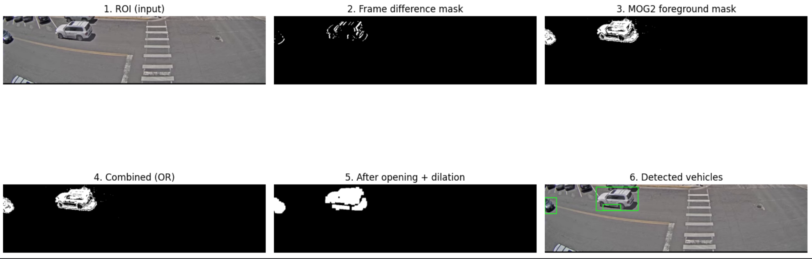
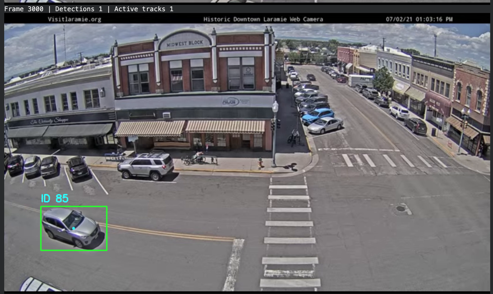
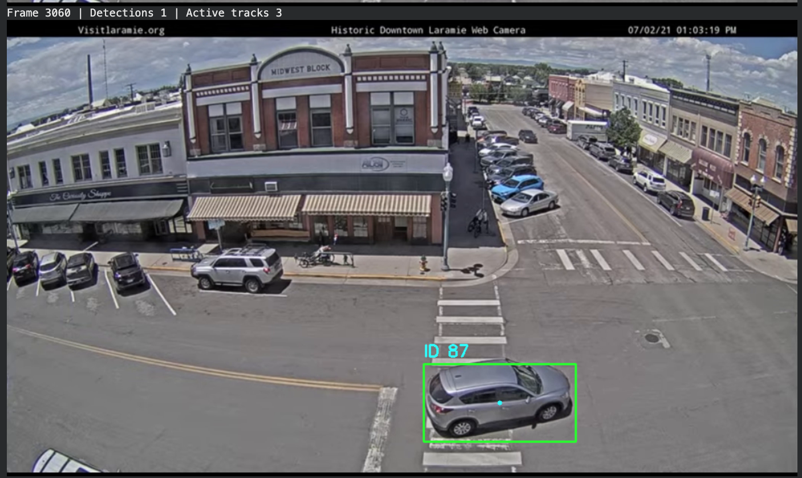
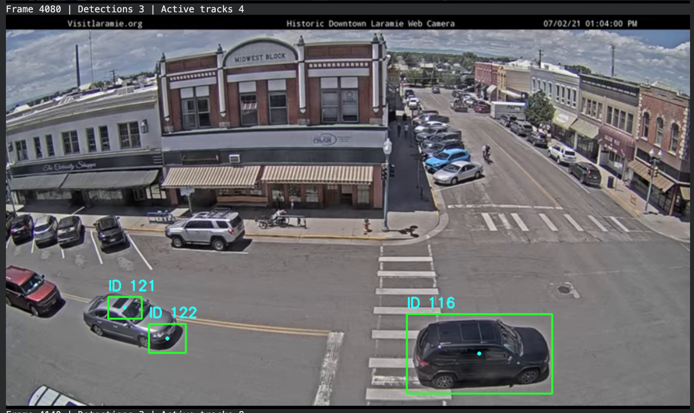
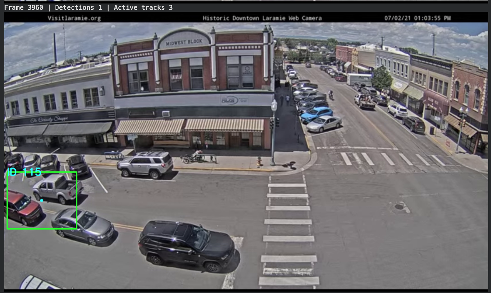
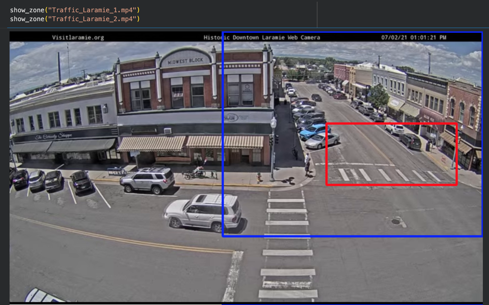

# Traffic Video Analysis with OpenCV

Detecting, tracking and counting vehicles in fixed-camera traffic recordings using classical computer vision (Python and OpenCV), with no machine learning model or training data.

| Notebook | What it does |
|---|---|
| `vehicle_detection_tracking.ipynb` | Detects moving vehicles and gives each one a tracking ID |
| `vehicle_counting.ipynb` | Reuses that pipeline and counts vehicles entering a zone on the road |

## How it works
1. **Region of interest:** only the part of the frame with the road is processed.
2. **Motion detection:** frame differencing and MOG2 background subtraction are combined with a bitwise OR.
3. **Mask cleanup:** morphological opening removes noise and dilation fills gaps.
4. **Detection:** contours above 900 pixels become vehicle detections.
5. **Tracking:** detections are matched to existing tracks by centroid distance, so a vehicle keeps its ID across frames.
6. **Counting (notebook 2):** a vehicle is counted when its tracked centroid moves from outside to inside a zone drawn on the road.



All tuning values (thresholds, kernel sizes, region of interest, zone) sit in one configuration cell at the top of each notebook.

## Part 1: Detection and tracking
Tested on a 3-minute clip (4,448 frames) from a downtown traffic webcam.

| Measure | Value |
|---|---|
| Vehicles counted manually | 17 |
| Track IDs created | 139 |
| IDs per vehicle | about 8 |

The manual count includes every moving car, SUV, truck or van that entered the lower street region, counted once. Parked vehicles, pedestrians and cyclists were excluded.

The number of IDs is not an accuracy score. It shows that motion detection picks up the vehicles, but the simple centroid tracker **fragments each vehicle into several IDs**.

### Failure cases
- **ID switch:** the same silver SUV is ID 85 at frame 3000 and ID 87 at frame 3060.
   
- **Split detection:** one gray sedan is covered by two boxes (IDs 121 and 122) at frame 4080.
  
- **Merged vehicles:** one box (ID 115) covers a pickup and a red SUV at frame 3960. Other vehicles in that frame have no box.
  

## Part 2: Counting vehicles in a zone
Counts vehicles entering a zone on the road (the red box below) during the first 2 minutes of two recordings. The blue box is the region of interest.



| Video | Original zone (far end of street) | Zone on the road |
|---|---:|---:|
| Traffic_Laramie_1.mp4 | 1 | 9 |
| Traffic_Laramie_2.mp4 | 3 | 4 |

The original zone covered mostly building fronts and the far end of the street, where vehicles are small. Moving it onto the road above the crosswalk raised the counts to 9 and 4.

These are counts of tracking IDs, not verified vehicle counts. As Part 1 shows, the tracker can give one vehicle several IDs, which could make the count too high, and small or distant vehicles may be missed. The counts have not been checked against a manual count.

## Possible improvements
Minimum track age to filter noise IDs, Kalman filtering, Hungarian assignment, merging fragmented boxes, a deep-learning detector such as YOLO, and counting vehicles when they cross a line instead of counting IDs.

## Run it
```
pip install -r requirements.txt
jupyter notebook
```
The notebooks expect `Traffic_Laramie_1.mp4` (and `Traffic_Laramie_2.mp4` for notebook 2) in the same folder. The videos are not included. To try them on other footage, use a fixed-camera traffic video and adjust the region of interest and zone in the configuration cell.

## About
Built for the Image and Signal Processing module of the University of London BSc Computer Science. The test videos are Visit Laramie downtown webcam recordings supplied with the coursework.
